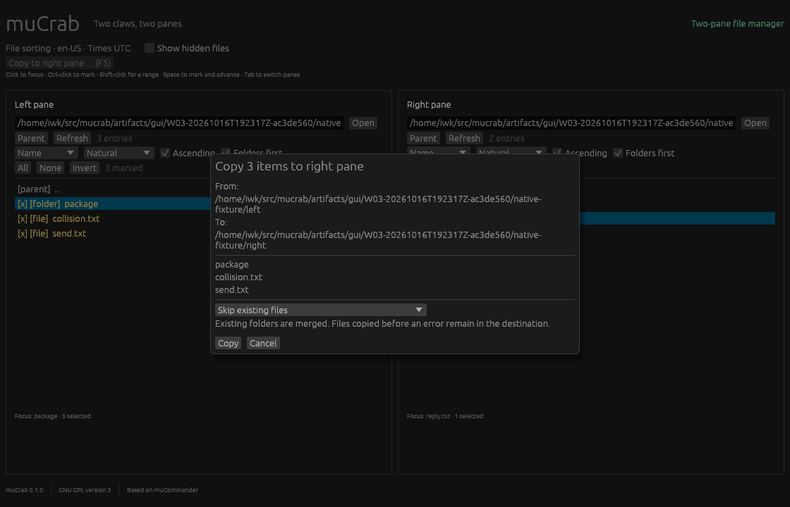
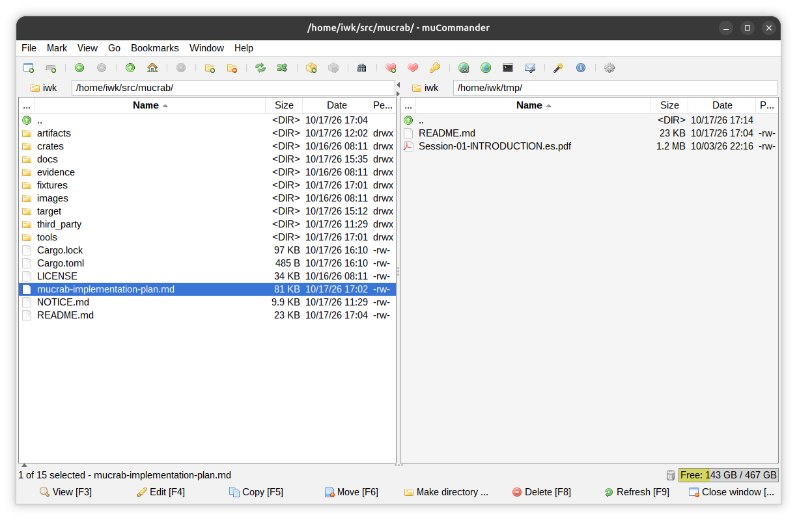

# muCrab

[](Cargo.toml)
[](#build-and-run-mucrab)
[](LICENSE)
[](docs/current-status.md)
[](docs/current-status.md#platform-scope-and-limitations)
[](docs/current-status.md#platform-scope-and-limitations)

**Two claws, two panes.**

muCrab is an experimental Rust port of selected file-management workflows from
[muCommander](https://github.com/mucommander/mucommander), reconstructed from its
published Java binaries. The application is **muCrab**; its command is **`mucrab`**.

muCommander is an open-source Java file manager for macOS, Linux, Windows and
other systems with Java support. Its two panes keep source and destination
folders visible side by side. The [original application](https://www.mucommander.com/)
supports copying, moving, renaming and batch renaming, alongside archives and
remote filesystems. These everyday operations make it a useful
subject for studying how an existing application's behavior can be recovered
and carried into a native Rust implementation.

The discovery idea comes from [REA — Reverse Engineer Anything](https://github.com/morluto/rea):
give a coding agent tools to inspect a compiled application, follow the evidence
behind a feature, and use those findings to build and test an implementation.
In this repository, the pinned REA probe inventories JAR contents and verifies
class fingerprints. JVM behavior is recovered with the CFR decompiler, JDK
`javap` bytecode inspection, and probes of the running original application.
The [analysis-tool evidence](evidence/toolchain/readiness.json) records what
each tool actually established.

Migration proceeds one workflow at a time:

1. **Inspect the reference.** Pin and checksum the official distribution, locate
   the relevant classes, and observe their methods and interface in isolation.
2. **Define the behavior.** Record inputs, outputs, errors and limits, then freeze
   fixtures and reserve additional cases before writing the Rust implementation.
3. **Implement and compare.** Run the original JAR methods and Rust code against
   equivalent fixtures; compare listings, selection state, file contents and
   metadata, and investigate differences.
4. **Integrate and record.** Connect the verified core to both native panes,
   exercise the original and Rust interfaces, rerun earlier suites, and retain
   contracts, results and a handoff checkpoint.

Upstream Java implementation source is withheld during reconstruction. The
published binaries, recovered representations and runtime observations supply
the behavior; the [implementation ledger](mucrab-implementation-plan.md) records
the scope and evidence for each increment. The resulting Rust application runs
without Java, REA or the reference JARs. The broader goal is to measure both
behavioral fidelity and the contribution of the discovery tools to migration.

## What is REA?

**REA connects AI coding agents to tools for investigating software, from
packaged applications and runtime behavior down to native binaries.** It
provides an MCP (Model Context Protocol) server, a CLI, and investigation
workflows. An agent can inspect a target, trace relevant code, examine the
returned evidence, and choose the next question to investigate.

Its analysis capabilities span several kinds of targets:

- **Native binaries:** assembly, pseudocode, strings, symbols, calls and
  references through engines such as Hopper, Ghidra or IDA.
- **Applications and managed code:** JavaScript/Electron modules and IPC,
  .NET metadata and instructions, and Android APK analysis through specialized
  providers.
- **Runtime behavior:** browser structure and network observations, plus local
  process interactions and execution captures.
- **Packages and resources:** file inventories, fingerprints, metadata and
  extracted resources.

The coding agent uses these findings to explain a feature, reconstruct an
implementation, and test it against the original. Available analysis depends
on the target, host and configured providers. See REA's
[investigation workflow](https://github.com/morluto/rea#how-rea-works) and
[supported targets](https://github.com/morluto/rea#what-you-can-analyze).

## Current status

Latest implementation checkpoint: **2026-10-18**, commit `5b77e5a` (W15).

**W15 — SFTP connections and transfers** is implemented. Go → SFTP connections
manages saved profiles, verified host keys and session-only or optional native
credentials. Browse remote folders, review local↔SFTP copies, and open/view files
through retained private downloads. Linux checks pass within the documented scope;
macOS build, Keychain and native interaction checks remain pending. See
[W15 evidence](evidence/workflows/W15-sftp-connections/README.md).

**W13 — Properties and permissions** and **W14 — Built-in viewer** are implemented.
**Alt+Enter** opens properties for the focused entry, with cancellable folder totals
and reviewed local permission/modified-time edits. **F3** opens a read-only text
or PNG/JPEG viewer with text find/copy and image fit/zoom/pan. Enter and double-click
continue to open files in their default application. Linux native checks pass;
macOS verification remains pending. See [W13 evidence](evidence/workflows/W13-properties-permissions/README.md)
and [W14 evidence](evidence/workflows/W14-built-in-viewer/README.md).

**W11 — Tabs and bookmarks** and **W12 — File search** are implemented.
Each pane has independent tabs; shared local/ZIP bookmarks persist across restarts,
with profile-backed SFTP bookmarks added in W15.
Background local search supports wildcard names, extension/type/size/UTC date
filters, cancellation, partial results and Open Containing Folder in either pane.
Linux native checks pass; macOS verification remains pending. See
[W11 evidence](evidence/workflows/W11-tabs-bookmarks/README.md) and
[W12 evidence](evidence/workflows/W12-file-search/README.md) for comparison scope
and remaining acceptance checks.

**W10 — Everyday file management** adds New Folder, reviewed Delete/Trash,
system clipboard Copy/Paste, type-to-find and per-pane Back/Forward history.
Linux X11 native checks and W07/W08/W09 regressions pass; native macOS W10 checks
remain pending. See [W10 evidence](evidence/workflows/W10-everyday-file-management/README.md).

**W09 — Default-application file opening** now supports local files and archive
members through Enter, double-click and File → Open. ZIP members open as private
temporary copies without archive writeback. Linux native dispatch is verified;
macOS dispatch is implemented and awaits native verification. See the
[W09 evidence](evidence/workflows/W09-open-files/README.md).

**W07 — background operations and cancellation** remains verified. File operations
show progress and support Pause/Resume/Cancel while
browsing remains available. **W08 — classic desktop UI** was delivered first, with
compact menus, file tables and saved Light/Dark/System appearance.
See the [current status report](docs/current-status.md) for workflow details,
comparison results, verification dates, supported platforms and remaining limits.

The pre-W09 [macOS arm64 verification](evidence/platforms/macos-arm64/README.md) covers all
nine comparison suites, full Rust/Python checks and native W07/W08 interaction.

## Migration screenshots

### muCrab — W08 interface screenshot

This screenshot records the W08 interface, before the later tabs, search,
properties, viewer and SFTP additions. It shows compact menus, an icon toolbar,
resizable file tables, a bottom command bar, and Light/Dark/System appearance.
It retains two independent
file panes, local and ZIP folder browsing,
name/metadata sorting, focus/marking, hidden-file filtering, and reviewed recursive
copy, move, single-item rename, batch rename and reviewed ZIP extraction. The native Rust application runs independently
of Java.



### muCommander — Java reference application

The original muCommander interface is the reference for recovering and comparing
the selected workflows. The screenshot shows its two-pane browser and broader
set of file-management features; the migration scope and comparison results are
recorded in the [current status report](docs/current-status.md).



## Release downloads

The [release workflow](.github/workflows/release.yml) builds **Linux x86_64** and
**Apple Silicon macOS** when a stable tag such as `v0.9.0` is pushed. After all
checks pass, archives, corresponding source with vendored dependencies, notices
and SHA-256 checksums are published under [GitHub Releases](https://github.com/soyrochus/mucrab/releases).
macOS bundles contain an ad-hoc signed `muCrab.app`; Developer ID signing and
notarization are not configured. The first hosted release run is pending.
See [release instructions and platform requirements](docs/releases.md).

## Build and run muCrab

Requirements: Rust **1.95** or newer, Cargo, and a native desktop session for the GUI. Linux source builds also need OpenSSL and DBus development packages (`libssl-dev`, `libdbus-1-dev` on Ubuntu); SFTP/credentials use system OpenSSL 3 and libdbus at runtime. macOS builds enable the locked vendored OpenSSL source. Linux file opening also requires `xdg-open` and configured file associations. W10 uses `gio` for Trash and `xclip` for importing native file selections under X11; pure Wayland clipboard publication is not implemented. Rust/Cargo **1.99.0** was used on macOS arm64 and Linux x86_64. The native GUI was exercised on macOS and under Linux X11/Xvfb; Wayland remains unverified.

The [Cargo workspace](Cargo.toml) contains:

| Package | Role | Current contents |
| --- | --- | --- |
| `mucrab-core` | Framework-independent behavior | Local/ZIP/SFTP providers, tabs/bookmarks/search, properties/view preparation, sorting/selection and reviewed file operations |
| `mucrab-desktop` | Native `mucrab` executable | Local/ZIP/SFTP two-pane browser, tabs, search, properties and viewer using eframe/egui 0.36.2 with the OpenGL backend |
| `mucrab-compare` | Java/Rust comparison harness | W01–W07 suites plus W10–W15 scoped original-binary probes/adapters and difference reports |

All three packages use `GPL-3.0-only` and are marked non-publishable. [Cargo.lock](Cargo.lock) pins the resolved dependencies; it is committed. Build and launch from the repository root:

```sh
cargo build --workspace --locked
cargo run --locked -p mucrab-desktop
# Optionally provide initial locations:
cargo run --locked -p mucrab-desktop -- /path/to/left /path/to/right
```

The application supports local/ZIP/SFTP browsing, tabs and bookmarks, local search,
properties and a built-in viewer. File operations include recursive local copy/move,
focused/batch rename, ZIP extraction, reviewed local↔SFTP copies and default-application
file opening. Running it requires no Java, Node, REA, or reference JARs. Hidden dotfiles start hidden; **Show hidden files** controls both panes. Double-click a regular folder or local `.zip` to enter it; each pane has an editable location, Parent and Refresh icons, and sortable column headers.
With the listing focused, **Enter**, double-click or **File → Open** opens the
focused/clicked file in its default application. Local symbolic links resolve
to their targets. Archive members open from private temporary copies retained
after muCrab exits; edits do not update the ZIP. Copies remain until OS temporary
cleanup or explicit user cleanup. Opening runs independently of copy/move jobs,
with cancellation during preparation and visible launcher errors.

Press Enter in the location field to open a typed location. View contains sorting/filtering options and
**Appearance → System / Light / Dark**; System follows the OS color preference
and falls back to Light if unavailable. ZIP paths such as `/path/archive.zip/folder` also work as initial locations. Check the native command-line entry points without opening a window:

```sh
cargo run --locked -p mucrab-desktop -- --version
cargo run --locked -p mucrab-compare -- --status
```

Status alone deliberately exits with **code 2**, `status: "not_run"`, and `cases_run: 0`. It never reuses a historical pass as a fresh comparison. Run the scoped suite after acquiring the reference and installing a full JDK:

```sh
cargo run --locked -p mucrab-compare -- --suite w01
cargo run --locked -p mucrab-compare -- --suite w01 --reserved
cargo run --locked -p mucrab-compare -- --suite w02
cargo run --locked -p mucrab-compare -- --suite w02 --reserved
cargo run --locked -p mucrab-compare -- --suite w02b
cargo run --locked -p mucrab-compare -- --suite w02b --reserved
cargo run --locked -p mucrab-compare -- --suite w02c
cargo run --locked -p mucrab-compare -- --suite w02c --reserved
cargo run --locked -p mucrab-compare -- --suite w03
cargo run --locked -p mucrab-compare -- --suite w03 --reserved
cargo run --locked -p mucrab-compare -- --suite w04
cargo run --locked -p mucrab-compare -- --suite w04 --reserved
cargo run --locked -p mucrab-compare -- --suite w05
cargo run --locked -p mucrab-compare -- --suite w05 --reserved
cargo run --locked -p mucrab-compare -- --suite w06
cargo run --locked -p mucrab-compare -- --suite w06 --reserved
# W07 observes real original jobs on an isolated Linux desktop:
xvfb-run -a cargo run --locked -p mucrab-compare -- --suite w07
xvfb-run -a cargo run --locked -p mucrab-compare -- --suite w07 --reserved
```

W04 comparisons and Rust move tests require unprivileged execution and two real
filesystems: the verified host uses repository ext4 and a different `/tmp` mount.
The comparison suite fails as unavailable if that arrangement cannot be
established; EXDEV is never mocked. Linux GUI checks also require Xvfb,
X11/XTest tools and Python Pillow.

The runner exits 0 for a complete scoped pass, 1 for differences, and 2 for unavailable/incomplete execution. Raw results are kept under ignored `artifacts/runs/`; compact reports are in each directory under `evidence/workflows/`. W01 requires a real access-denied fixture, so running with privileges that can read it cannot produce a passing W01 result.

Workspace checks:

```sh
cargo fmt --all -- --check
cargo clippy --workspace --all-targets --all-features --locked -- -D warnings
cargo test --workspace --all-features --locked
python3 -B -m unittest discover -s tools -p 'test_*.py' -v
```

The W15 Linux checkpoint passes **106 Rust tests** and **51 Python tests**, plus
formatting, Clippy and the locked all-feature build. The ordinary workspace run
ignores four service-dependent tests: one historical W10 test and three W15 tests.
The W15 service checks are separately exercised against real disposable SFTP and
isolated credential services. Coverage includes local/ZIP operations, navigation,
tabs/bookmarks/search, properties/viewer, remote profiles/trust, staged transfers
and temporary-copy opening. Separate Java/Rust comparisons and native GUI checks
record their scope and source provenance in the
[current status report](docs/current-status.md). Once dependencies
are cached, Cargo build, test, and Clippy commands also work with `--offline`.

**F7** reviews creation of a folder in the active local pane. **F8/Delete**
reviews moving selected entries to the OS Trash; **Shift+F8/Shift+Delete** separately
reviews permanent deletion. Failure to trash never falls back to permanent deletion.
With listing focus, **Ctrl/Cmd+C/V** exchanges native file selections and reviews
Paste into the current local folder. Text fields retain normal clipboard editing.
Type a prefix to find a visible name; Enter or Escape dismisses find before file
activation. **Alt+Left/Right**, Go menu actions and toolbar arrows navigate each
tab's independent session history, including ZIP and profile-backed SFTP locations.
Clipboard Cut and Trash restore/emptying UI remain deferred. Linux X11 is verified;
native macOS W10 verification and real IME input remain pending.

**Ctrl/Cmd+T** opens a Home tab; **Ctrl/Cmd+Shift+T** duplicates the current tab;
**Ctrl/Cmd+W** closes it, retaining at least one tab per pane. **Ctrl+Tab** and
**Ctrl+Shift+Tab** switch tabs. Tabs retain their own history, marks, sorting and
column widths and are session-only. **Ctrl/Cmd+B** bookmarks the location;
Go → Bookmarks opens, renames, reorders or removes saved local/ZIP/SFTP bookmarks.
SFTP bookmarks reference a saved profile and remote path; they contain no credentials.

**Ctrl/Cmd+F** or Go → Search files opens a separate search window. Choose a local
root and a name pattern (`*`, `?`, or backslash to escape the next character),
then optionally set extension, types, byte-size bounds and modified dates in UTC.
Date-only To includes that day; timestamp To is exclusive. Matching defaults to
case-insensitive Unicode lowercase, without canonical normalization. Hidden
folders are pruned unless included; links and descendant mounts are never
traversed. Search stops visibly partial at 10,000 hits, one million visited
entries or depth 256. Cancel retains results; replacing waits for cancellation.
Double-click a result or use Open Containing Folder to focus its name in the
currently active tab. Search can run alongside a file operation.

For **SFTP**, open Go → SFTP connections, enter a profile ID, host, port, user,
authentication method and absolute initial directory, then Save profile and
Connect. Passwords and key passphrases are separate session fields. First use
shows the server's algorithm and SHA-256 fingerprint before authentication;
a changed key is refused until a separate trusted-host removal. Remember Secret
is explicit opt-in to Linux Secret Service or macOS Keychain; there is no
plaintext fallback. Saved credentials are bound to the connection settings. Linux locked/unavailable stores visibly fail; use session-only
authentication or unlock the OS store separately.

Remote tabs support sorting, marks, hidden filtering, history and profile-backed
bookmarks (`sftp://profile-id/path`). **F5** reviews local↔SFTP copies with Skip or
Overwrite. Hidden descendants are included, links/special files are rejected, and
owned staging paths remain visible after failure/cancellation. Overwrite requires
the server's advertised POSIX-rename extension; it never deletes the destination
first. Remote metadata checks use kind/size/whole-second time, with weaker identity
guarantees than local files. Failed or uncertain publication is never retried
automatically. Only one mutation job runs; browsing remains separate.

Remote Enter/double-click downloads a regular file for the default application;
**F3** downloads for the built-in viewer. Private owner-only copies retain the
filename, survive application exit and never write back. The download limit is
512 MiB, with W14's smaller viewer limits still applying. Remote archives require
an explicit Copy to a local folder first. Remote↔remote copies, move/rename/delete,
New Folder, permission edits, search, clipboard export, SSH agents/MFA and other
protocols remain unsupported. SSH calls have finite timeouts; cancellation waits
for acknowledgment and does not undo completed work.

**Alt+Enter** or File → Properties captures the focused entry, independently of
marks. Local properties show link metadata without following its target, available
timestamps, owner/group, Unix mode and link count. Folder totals include hidden
entries, count hard links per name and skip link targets and descendant mounts;
limits or errors are reported as partial. Local files/folders support reviewed,
non-recursive rwx and RFC3339 modified-time edits, preserving special bits and
access time. ZIP properties are read-only; host-only fields are unavailable.

**F3** or File → View opens the focused file in the built-in viewer. Text supports
strict UTF-8 and BOM-tagged UTF-16, exact decoded newline/clipboard content,
selection and literal case-sensitive find. Limits are 16 MiB input, 100,000 lines
and 64 KiB per decoded line. PNG/JPEG viewing supports orientation, transparency,
fit/100%, zoom and drag-to-pan, with 32 MiB encoded / 64 MiB decoded limits and
GPU-dependent dimensions. Unsupported or malformed files show an error; Open
externally is an explicit action. ZIP viewing uses private copies removed on
viewer close; externally opened copies retain W09's separate lifetime.
The bundled font may lack some glyphs. Viewer reads and folder totals can run
alongside a file operation; cancellation waits for blocked OS/decoder calls.

Click a row to give its listing keyboard focus. Ctrl-click toggles a mark and
Shift-click toggles a range; Space toggles and advances. Up/Down, Home/End, and
Shift+Up/Down move/select; Tab switches panes. Cmd+A/Cmd+D (Ctrl on non-macOS)
mark/unmark all; Mark all/Unmark all/Invert selection are also available in the Mark menu. F5 reviews a copy
to the other pane; F6 reviews a move and F2 renames the focused child, even when
other children are marked. **Batch rename…** reviews the effective selection
with live generated names and an explicit Apply button. Batch operations skip
existing files; copy/move/single rename initially select the same policy. Successful
top-level items are unmarked, skipped items stay marked, and both panes refresh.
The result details report failed children even when their parent folder was
processed. The status area shows job progress with Pause/Resume/Cancel; browsing stays
available while one mutation job runs. Cancel preserves completed work and may
leave a partial destination file; an unfinished fallback move retains its source.
Closing the window waits for the worker to acknowledge cancellation. A focused row is
highlighted; marked rows use a dot and theme-aware colors. With no marks, the focused child is the effective
selection. The parent row can be focused but is never included in file selection.

Use **Extract ZIP…** on one selected local ZIP to extract the whole archive,
including hidden entries. Inside a ZIP, it extracts the effective selection;
selected folders include hidden descendants. F5 also opens this review while
the archive listing has keyboard focus. Archive move/rename/batch controls and
writes into archives are disabled. Extraction merges folders, starts with Skip,
and stops at its first actual transfer error. Earlier writes remain; Details
shows skipped/failed paths. The ZIP stays unchanged.

This increment accepts ordinary ZIP32 stored/deflate files with ASCII/UTF-8
names and UTC DOS timestamps. Native guards reject unsafe paths, archive links,
ambiguous duplicates and destination links/aliases, and enforce 512 MiB archive/
entry, 2 GiB expanded total, 20,000 tree entries and 64 path-component limits.
ZIP64, encryption, other methods/encodings, extended timestamps, nested archives
and archive creation/editing remain outside the verified scope. Static guards
and stale-review checks do not provide race-free filesystem handling.

Capture the native browser and exit automatically (verified on macOS):

```sh
mkdir -p artifacts/workspace
EFRAME_SCREENSHOT_TO="$PWD/artifacts/workspace/mucrab-preview.png" \
  cargo run --locked -p mucrab-desktop --features screenshot
```

The optional `screenshot` feature is for development captures.
[Workspace readiness evidence](evidence/workspace/readiness.json) is the historical
phase 4 scaffold snapshot. [W15 evidence](evidence/workflows/W15-sftp-connections/README.md)
records the latest SFTP checks and W07–W14 regression provenance. Earlier workflow
evidence retains its original comparison results. W09 currently has static
original-binary recovery and native Linux checks, rather than a Java/Rust runtime
parity suite. A screenshot supplements runtime comparisons.

## Reference application

The reference is muCommander **1.6.2**, release tag **`1.6.2-1`**:

- [Official release](https://github.com/mucommander/mucommander/releases/tag/1.6.2-1).
- [Binary distribution](https://github.com/mucommander/mucommander/releases/download/1.6.2-1/mucommander-1.6.2-1-portable-x86_64.zip).
- Published archive SHA-256: `e6769537bbb56cc52c1289ebef2e3d051912bb8b10691d320f28b945f15819a4`.

The input is the complete distribution, including the launcher, application JARs,
dependencies, resources, and notices. This portable archive includes a Windows
executable launcher and a shell launcher, with no bundled JRE. Original classes
and isolated GUI copies have been exercised on macOS arm64 for earlier workflows
and Linux x86_64 through W06. Those checks do not verify unrelated bundled
components. Acquisition preserves the distribution layout and does not execute
its contents.

## Acquire or verify the reference

Requirements: Python 3.9 or newer, `curl`, and network access for the first download. From the repository root:

```sh
python3 -B tools/acquire_mucommander.py
```

The [pinned manifest](tools/manifests/mucommander.json) supplies the official release URL, archive size, and SHA-256. The script verifies the archive before extraction, checks all extracted file contents, and confirms the launcher version, implementation revision, and preserved license notice. Repeating the command verifies the cached archive and distribution before reusing them. A mismatch stops acquisition and reports the affected input.

- Download: `artifacts/downloads/mucommander-1.6.2-1-portable-x86_64.zip`.
- Extracted reference: `artifacts/reference/mucommander-1.6.2-1/`.
- Launcher JAR: `artifacts/reference/mucommander-1.6.2-1/mucommander-1.6.2.jar`.
- Core JAR: `artifacts/reference/mucommander-1.6.2-1/app/mucommander-core-1.6.2.jar`.
- Full file inventory: `artifacts/inventories/mucommander-1.6.2-1.json` (ignored).
- [Acquisition evidence](evidence/acquisition/mucommander-1.6.2-1.json) (tracked).

The acquired distribution contains **202 files and 196 JARs**. The compact evidence records the input digest, distribution counts, and selected file digests; the local inventory contains the digest of every extracted file. These records establish acquisition and byte integrity only.

Verify the local reference and its evidence without network access or writes:

```sh
python3 -B tools/acquire_mucommander.py --verify-only
```

Check acquisition failure handling and extraction boundaries:

```sh
python3 -B -m unittest discover -s tools -p 'test_*.py' -v
```

Keep the extracted tree unchanged as the binary reference. Runtime tests use
separate working copies, disposable configuration and isolated fixture trees.

## Analysis tools

**REA's role in this experiment:** the pinned local CLI has supplied artifact
inventory and fingerprint evidence for the muCommander JAR. Java method recovery
uses CFR and JDK `javap`; our Java adapters execute the original classes, and our
comparison harness checks the Rust implementation. The capability table below
records what each tool has actually demonstrated in this repository.

The [analysis-tool manifest](tools/manifests/analysis-tools.json) pins **REA 6.5.0** and **CFR 0.152**. REA's dependencies are pinned in [the npm lockfile](tools/rea/package-lock.json). The latest probe ran on Linux x86_64 with Node **24.15.0**, npm **12.0.2**, and OpenJDK / `javap` **25.0.4.1**. Setup requires a Node version supported by REA and a full JDK 17 or newer; it uses the installed runtimes rather than installing them.

Install the tools locally, with npm lifecycle scripts disabled:

```sh
python3 -B tools/analysis_tools.py setup
```

Repeat installation from the populated local cache without network access:

```sh
python3 -B tools/analysis_tools.py setup --offline
```

Run the static capability probe against the verified muCommander reference:

```sh
python3 -B tools/analysis_tools.py probe
```

The probe does not download tools, execute muCommander classes, or modify global agent configuration. It writes raw command arguments, stdout, stderr, bytecode, and decompiler output under ignored `artifacts/analysis/toolchain/`. Its compact [readiness evidence](evidence/toolchain/readiness.json) is tracked in Git and records each producer, version, command, output digest, and limitation.

| Producer | Observed capability | Boundary |
| --- | --- | --- |
| REA `inspect-artifact` | Inventoried the file-library JAR and verified the selected class fingerprint | Coverage concerns ZIP entries; the class format is reported as `unknown`, with no JVM method semantics |
| REA `inspect-android-package` | Explicitly rejected the JAR because it requires a standalone APK | This is an expected format refusal, not a successful Java decompilation |
| CFR | Decompiled `FileComparator` into 163 lines of Java with its dependencies resolved | One static smoke test; output correctness is not established |
| JDK `javap` | Returned method signatures and bytecode instructions for the same class | Disassembly supports investigation; it does not establish equivalence |

The selected class was previously examined during the feasibility investigation. This repeatable probe establishes tool readiness and must not be presented as a blind reconstruction or a new behavioral discovery. The input class has JVM class-file major version **55**.

REA is installed under ignored `tools/rea/node_modules/`; CFR is stored under ignored `tools/.cache/cfr/`. The npm lockfile carries REA's registry integrity value. CFR's SHA-256 was computed from the official author download and pinned locally; the author's published MD5 also matches. That SHA-256 is a reproducibility pin, not a publisher-supplied signature. Preserved tool licenses and provenance are listed in [NOTICE.md](NOTICE.md).

No JADX, Hopper, Ghidra, or other native analysis engine is needed for these probes.
Native, browser, and instrumentation providers are outside the static probe's
verified capabilities. Original-Java execution, scoped comparisons and GUI
observations are recorded separately for each implemented workflow.

## Initial demo scope

| Workflow | Intended comparison |
| --- | --- |
| Two-pane navigation and selection | Locations, listings, and selection behavior |
| Sorting and filtering | Ordering, numeric names, locale behavior, and ties |
| Recursive copy, move, and rename | Resulting paths, contents, and selected metadata |
| Batch renaming | Generated names, collision handling, and errors |
| ZIP browsing and extraction | Entry names and extracted contents |
| Background file operations | Completion, cancellation, and failure outcomes |

This scope is an initial demonstration target. Complete muCommander feature parity, remote and cloud filesystems, additional archive formats, and support across operating systems require further increments.

## Execution sequence

The [implementation plan and progress ledger](mucrab-implementation-plan.md) records the current checkpoint, machine handoff instructions, workflow gates, and evidence requirements. Update it during implementation so work can resume in another session or checkout.

1. **Complete:** establish and commit this repository baseline.
2. **Complete:** add reproducible acquisition scripts and a checksum manifest; download and extract the reference into ignored local storage.
3. **Complete for static inspection:** pin REA and a JVM decompiler, verify JAR inventory, the APK-only refusal, class decompilation, and bytecode inspection against the reference, and record tool provenance and limits.
4. **Complete:** create a GPLv3 Cargo workspace separating the Rust core, native desktop interface, and comparison-harness entry point; commit `Cargo.lock`, verify the build and unavailable-harness guard, and capture the native preview.
5. **In progress:** W01 browsing/name sorting, W02a selection/marking, W02b hidden-file filtering, W02c size/date/extension sorting, bounded W03 recursive copy, W04 move/rename, W05 batch rename and W06 ZIP browsing/extraction are verified within their contracts. W08 implements the classic desktop interface as a presentation increment. W07 adds bounded background operations, progress and cancellation with original full-job lifecycle comparisons. W09 implements default-application opening for local files and retained archive copies, with Linux native verification and macOS verification pending. W10 implements New Folder, Delete/Trash, clipboard Copy/Paste, quick-find and history, with Linux checks passing and Mac verification pending. Permissions/owner/group sorting and additional filters remain deferred.
6. Run the agreed comparison suite and demonstrate fresh scenarios with the compiled Rust application running independently of Java.

Upstream Java implementation source will be withheld during reconstruction; license and attribution material remains available. Decompiled representations, binary metadata, and observations of the original are permitted inputs. Findings from the earlier feasibility investigation must be identified as prior evidence if reused.

## Verification approach

Each workflow will have explicit inputs and acceptance criteria established before its Rust implementation. A harness will exercise the original JARs and the Rust implementation against equivalent fixtures, comparing observable results and recording discrepancies. Any normalization of paths, timestamps, or platform details must be stated explicitly.

W01 through W06 have scoped original-JAR/Rust comparisons, reserved cases,
integrity checks and representative GUI evidence. The broader demo still needs
broader platform/end-to-end acceptance; W07 now covers bounded job lifecycle
and cancellation separately from the earlier component case counts.

Current fixtures include numeric and Unicode names, existing destinations,
symbolic links, unreadable files, and partial copy/move failures. File operations
run inside disposable fixture directories. W07 adds cancellation, paused jobs,
partial-prefix checks and real cross-device source-retention fixtures.
W09 adds default-application dispatch, retained archive copies and an isolated
Linux MIME-association replay; native macOS dispatch remains unverified.
GUI demonstrations supplement the behavioral comparisons. Build success alone
does not establish equivalence.

The experiment will distinguish evidence that binary-to-Rust reconstruction works from evidence that REA improves the process. Tool provenance, human interventions, and remaining gaps will be recorded with the results.

## Repository layout

- `artifacts/`: ignored downloads, extracted distributions, and generated decompiler output.
- `tools/`: reproducible acquisition, inspection, and comparison helpers.
- `crates/`: Rust application and comparison components.
- `fixtures/`: reproducible test inputs.
- `evidence/`: selected provenance records and comparison results suitable for Git.
- `third_party/`: preserved upstream notices and their provenance.

The repository includes acquisition/analysis helpers, pinned manifests and
lockfiles, the native workspace, W01/W02a/W02b/W02c/W03/W04/W05/W06 Java/Rust adapters
and fixtures, scoped results, GUI evidence, and the maintained implementation
plan. [W08 UI evidence](evidence/workflows/W08-desktop-ui/README.md) records the
UI changes and scoped checks. [W07 evidence](evidence/workflows/W07-background-operations/README.md)
records lifecycle recovery, comparisons and native progress/cancellation checks.
[W09 evidence](evidence/workflows/W09-open-files/README.md) records default-application
opening, temporary-copy lifetime and native Linux verification; W05 manual row
overrides remain deferred.

## Principles of Participation

Everyone is invited and welcome to contribute: open issues, propose pull requests, share ideas, or help improve documentation. Participation is open to all, regardless of background or viewpoint.

This project follows the [FOSS Pluralism Manifesto](./FOSS_PLURALISM_MANIFESTO.md), which affirms respect for people, freedom to critique ideas, and space for diverse perspectives.

Before submitting a change, complete its verification tasks and update the
relevant OpenSpec artifacts when behavior or requirements change.

## License and attribution

Copyright (c) 2026 Iwan van der Kleijn

muCrab-authored material is licensed under the **GNU General Public License, version 3** (`GPL-3.0-only`); see [LICENSE](LICENSE). Upstream material retains its original copyright notices and applicable terms. See [NOTICE.md](NOTICE.md) and the [preserved muCommander license file](third_party/mucommander/license.txt).

Distribution of the Rust executable will include the corresponding buildable source, build instructions, the GPL text, and applicable notices. Additional dependencies and copied material must retain their own notices and be compatible with the application's distribution terms.
