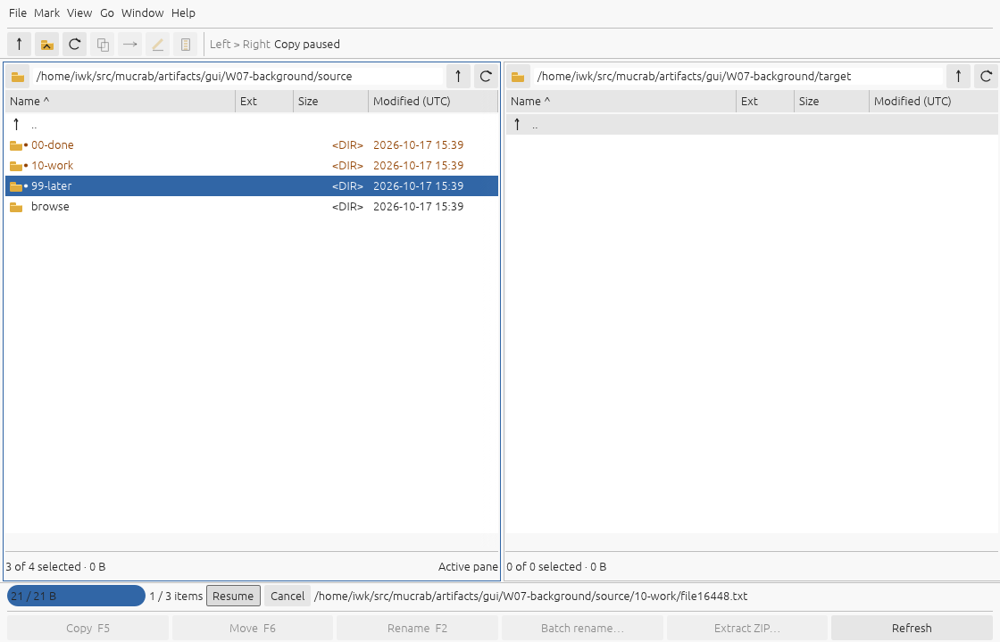
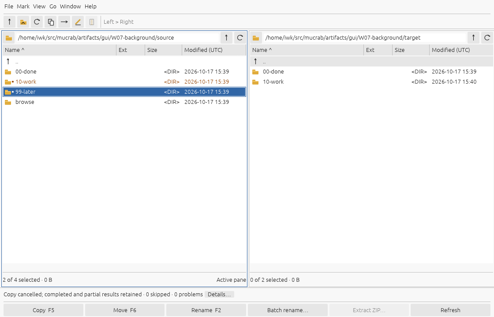
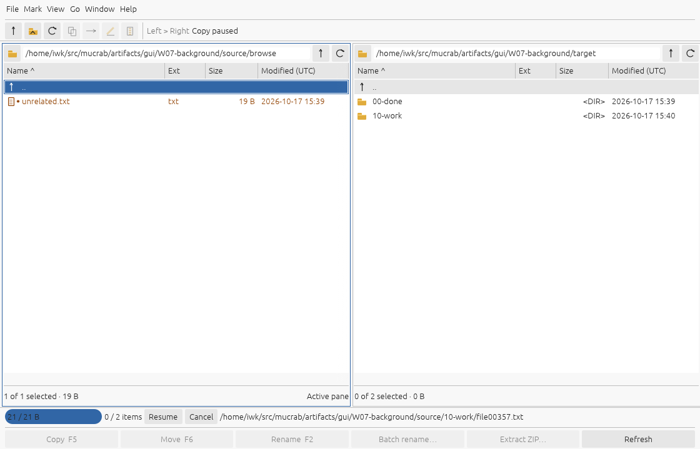

# W07 — background operations, progress and cancellation

W07 follows the prioritized W08 UI increment. Copy, move/focused rename, batch
rename and ZIP extraction now share cooperative control and a worker lifecycle.
The classic two-pane UI stays available for browsing, marking and sorting; the
status area shows current-file bytes, completed/total work items and
Pause/Resume/Cancel. A window-close request cancels and waits for acknowledgement.

Cancellation preserves earlier completed work and may retain an incomplete
file at the destination, including after overwriting. Fallback moves keep the
unfinished source. Atomic renames already committed remain committed. An
interrupted root and later selections stay marked. See [contract.md](contract.md)
for exact boundaries and item-count definitions.





## Evidence

- [recovery.json](recovery.json): pinned binary hashes, javap and CFR recovery of
  nine original classes, including FileJob, TransferFileJob and AbstractFile.
- [comparison-predefined.json](comparison-predefined.json): 18 cases.
- [comparison-reserved.json](comparison-reserved.json): 12 separately seeded cases.
- **30 cases, zero differences** within the contract: actual original
  `start/run/interrupt/setPaused` and concrete jobs, final source/destination
  contents and marks, completion/skip/error cases, cancellation before mutation,
  mid-stream and nested copy, real cross-device move retention, ZIP cancellation,
  pause/resume stability and terminal interrupt idempotence.
- [regressions.json](regressions.json): all 16 earlier predefined/reserved suite
  executions pass; their owning comparison reports were refreshed. W08's existing
  54-action native replay and verifier also pass on the W07 build.
- [validation.json](validation.json): 46 Rust tests, 49 Python tests, locked offline
  build, formatting and Clippy; seven core lifecycle tests and three desktop
  worker tests are new. Snapshot/panic/late-cancel/second-job/navigation guards
  supplement the original comparison.
- [gui-observations.json](gui-observations.json): 27 native actions and 17 captures
  against 20,000 real source files. Three cancelled copy jobs exercise actual
  Pause/Resume/Cancel, disabled mutation controls, unrelated navigation/marks,
  result details and normal exit after cancelling a paused worker. The verifier
  checks every source/remaining destination byte and untouched later roots.

The original startup agent observes the full unmodified application, uses real
jobs, retains a listener strongly, waits for the actual job thread to leave
`run()`, and checks table marks on the event thread. It neither overrides
application methods nor transforms classes. Calls into protected setup methods
use reflection; original semantics execute from the pinned distribution. A
separate runtime copy and disposable configuration preserve the reference tree.
Native progress observers schedule equivalent byte milestones without mocking
filesystem operations.

Exact partial-file lengths, scheduling and throughput are not compared. Each
stream cancellation must leave a nonempty proper source prefix, earlier completed
files and untouched later work; source bytes and move retention are independently
checked. Original FINISHED includes fixed-policy skipped/error items, matching
native finished-with-problems reporting. Native Cancelling/Cancelled distinguish
request from acknowledgement; native Failed handles unhandled worker/preflight
errors. Dates/modes on interrupted files and runtime directory clocks are omitted;
completion metadata remains covered by the earlier suites.

REA supplies no new semantic evidence for W07. Binary fingerprints, CFR/javap,
live original calls, independent filesystem inspection and native tests establish
the scoped behavior. Initial observer attempts failed on reflective access and
the JDK screen-capture portal; the successful probe uses Swing `printAll` rather
than Robot screen capture. Failed raw runs are not counted as passing cases.

## Reproduce

```sh
cargo build --workspace --locked --offline
python3 -B tools/w07_inspect.py
xvfb-run -a -s '-screen 0 1280x900x24' target/debug/mucrab-compare --suite w07
xvfb-run -a -s '-screen 0 1280x900x24' target/debug/mucrab-compare --suite w07 --reserved
cargo test --workspace --all-features --locked --offline
python3 -B -m unittest discover -s tools -p 'test_*.py' -q
```

Use unprivileged Linux and two real filesystems (repository ext4 and `/tmp` on
the verified host). No EXDEV mocking or privileged permission-fixture pass.
The native replay uses a stable path/window and refuses to overwrite a prior
run; preserve or move `artifacts/gui/W07-background` before preparing again:

```sh
python3 -B tools/w07_gui.py prepare
xvfb-run -a -s '-screen 0 1280x900x24' python3 -B tools/linux_gui.py artifacts/gui/W07-background/launch.json --replay fixtures/W07-background-operations/native-gui-actions.json
python3 -B tools/w07_gui.py verify
```

## Limits

Control is cooperative between entries and 64 KiB stream chunks. Blocking OS
calls and atomic renames must return before cancellation can be acknowledged.
Cancel is not rollback and does not restore a truncated overwrite destination.
One mutation job runs at a time; review/preview and existing directory-loading
work retain their earlier UI behavior. Full original scheduler concurrency,
remote jobs, retry prompts, throughput controls, checksums, process-kill recovery
and race-free filesystem mutation remain out of scope. Linux X11/Xvfb is verified;
macOS/Wayland/physical-desktop behavior still needs platform checks.
