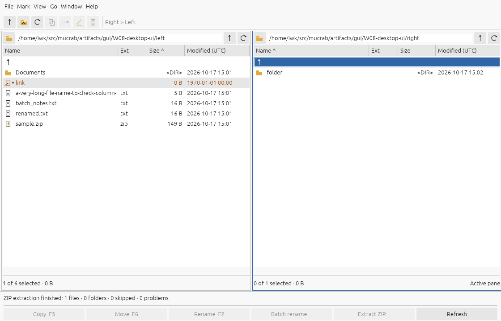
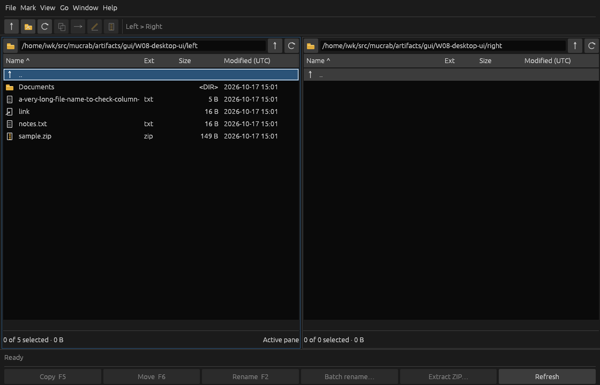
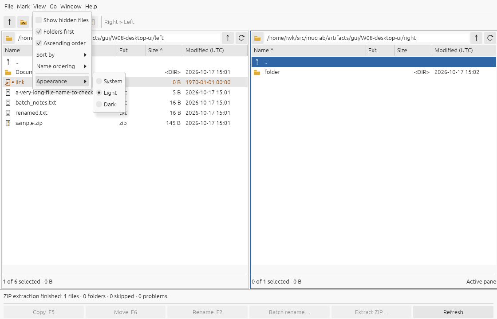
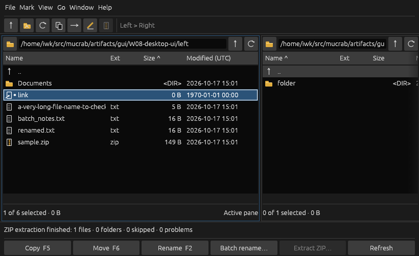

# W08 — classic desktop interface

W08 runs before W07 at the user's request. See [contract.md](contract.md) for the
accepted presentation/interaction scope and [validation.json](validation.json)
for fresh checks and source fingerprints.

The reference is reused evidence: [muCommander screenshot](../../../images/mucommander.png)
and [original menu hierarchy](../W02-selection-marking/gui/reference-range.ax.txt).
The compact shell, tables and command bar replace the prototype's oversized
branding, stacked controls and text-only lists. Core file-management semantics
remain those of W01–W06; their historical Java comparisons are not relabeled as
fresh W08 comparisons. REA contributes no new evidence to this visual increment.






## Repeat the native check

Build with `cargo build --locked --offline -p mucrab-desktop`. Preparation uses
`artifacts/gui/W08-desktop-ui` and refuses to overwrite an existing run; preserve
or move an earlier run before repeating. This stable path and 1120×720 window
keep the pixel-coordinate replay reproducible.

```sh
python3 -B tools/w08_gui.py prepare
xvfb-run -a -s '-screen 0 1280x900x24' python3 -B tools/linux_gui.py artifacts/gui/W08-desktop-ui/launch.json --replay fixtures/W08-desktop-ui/native-gui-actions.json
python3 -B tools/w08_gui.py verify
```

The replay starts with a saved Dark preference, switches to Light, then saves
System. It navigates a folder, copies a file left→right, renames it, moves it
right→left, batch renames the remaining source, browses a ZIP and extracts a
folder. It then exercises marking/sorting, column/pane resizing, the minimum
window, hidden files and Help. Verification checks the exact replay, both final
trees, contents, source ZIP digest, saved System preference and palette pixels.
The deliberate single-name rename leaves the fixture's relative symlink dangling;
its target text must remain unchanged.

Headless theme/table regressions run in `cargo test -p mucrab-desktop --locked`.
OS changes in that test are injected egui inputs, not physical desktop
notifications. Existing Rust/Python suites and Clippy are also recorded.

## Limits

The menus currently render inside the window, including on macOS. macOS native
menu integration, physical OS theme-change delivery, Wayland and display scaling
need platform checks. Bookmarks/history, additional metadata, disk free space,
new operation types, and W07 progress/cancellation remain outside this increment.
