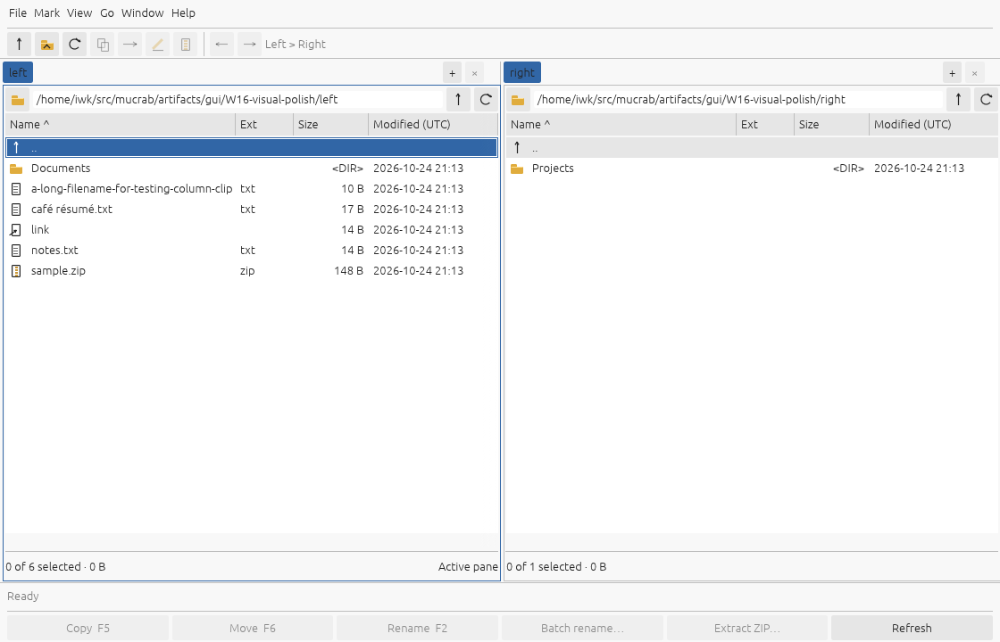
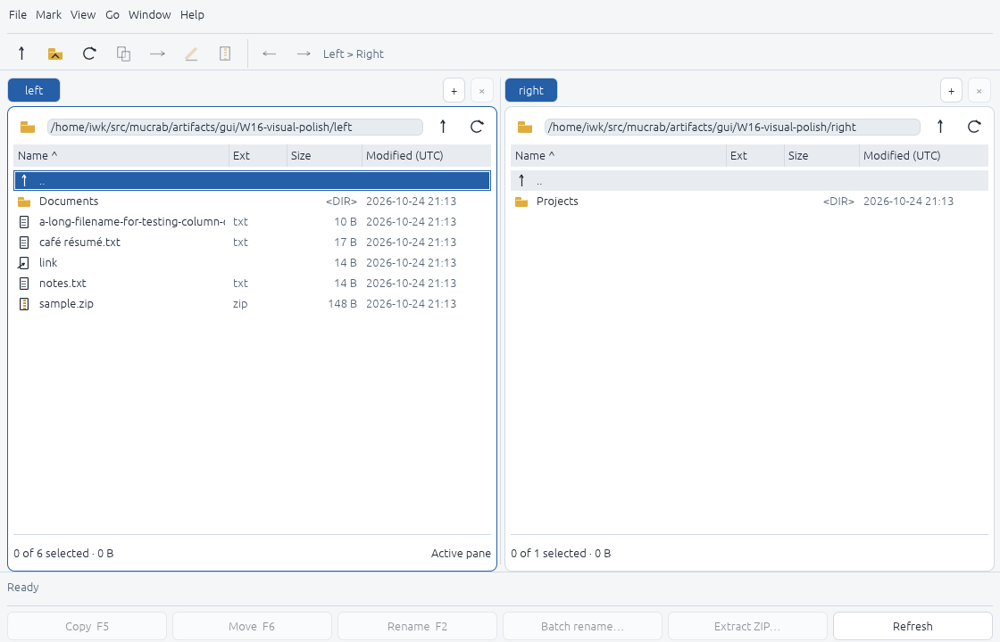
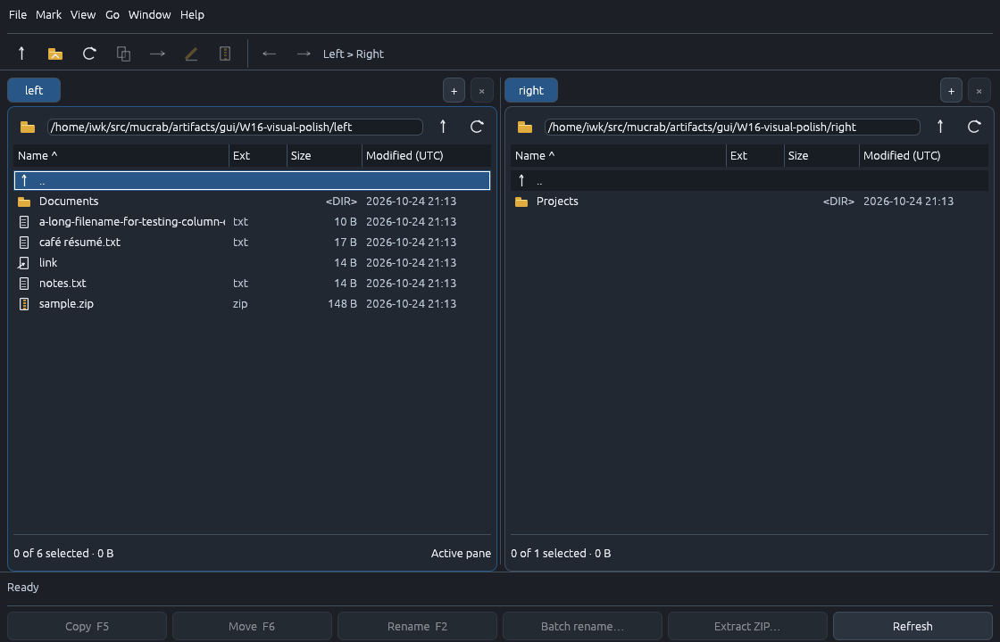

# W16 visual and interaction evidence — 2026-10-24

Fresh captures use the implemented W15-era application as the baseline, not the
historical W08 screenshots. Both versions browse the same disposable fixture tree
under `artifacts/gui/W16-visual-polish/`. The preserved baseline executable and the
updated executable use isolated XDG preferences, the same bundled fonts and the
same Linux x86_64/Xvfb/X11/software-OpenGL environment.

## Visual matrix

| Appearance | Scale | Normal logical window | Minimum logical window |
|---|---:|---|---|
| Light | 100% | 1120×720 | 820×500 |
| Dark | 100% | 1120×720 | 820×500 |
| Light | 200% | 1120×720 (2240×1440 physical) | 820×500 (1640×1000 physical) |
| Dark | 200% | 1120×720 (2240×1440 physical) | 820×500 (1640×1000 physical) |

Matching 100% before/after captures include the workspace, focused and marked rows,
copy confirmation, text viewer and search. The 200% matrix checks the new rendering
at the same logical sizes. Screenshots retain the virtual desktop bounds; black
space outside a resized application is not application content.

Inspected alignment, compact row density, active-pane/focus/mark distinction,
metadata hierarchy, navigation targets, long path/name clipping, selected text,
confirmation emphasis and normal/minimum layouts. Long path values remain fully
editable, and metadata tables retain horizontal scrolling. No font or icon asset
was added. Automated contrast checks found and corrected the dark pressed-state
secondary text colour; both installed palettes now pass the tested text, selection,
focus, warning and error contrast properties.

## Native interactions

Isolated XTest replays exercise pane switching, splitter resizing and reset,
metadata-column resizing, path editing, history return, duplicate/close tab, focus,
marking, copy confirmation/cancel, text viewer, search and minimum-size resizing.
The path replay exposed Enter being processed twice: a submitted path also
activated the listing's parent row. A failing regression test now passes after the
path editor consumes Enter. Splitter double-click reset also now requests click
and drag sensing, preserving ordinary drag behaviour.

No mutation confirmation was accepted by these visual traces. Core operation
outcomes, cancellation and clipboard routing are covered by separate Rust tests;
these screenshots are not a claim of full operation or original-application parity.
The shared styles also apply to the existing properties, bookmarks and SFTP
surfaces, whose service/native-platform gates remain separate.

`captures.json` records screenshot hashes, binary hashes, host, scale and trace
paths. Curated captures and action traces are stored in `gui/`. Raw application
logs and additional captures stay under the ignored artifact run.

## Before and after

Light before:

Light after:

Dark after:

## Limits

Native macOS presentation/menu checks, physical OS theme-notification delivery and
Wayland were not exercised. The existing injected live-theme regression passes,
but is not evidence of physical OS notification delivery. Hosted CI has not been
run from this working tree. Earlier W09–W15 unfinished gates remain open, and both
W16/W17 retain explicit macOS acceptance tasks instead of being archived as fully
verified changes.
